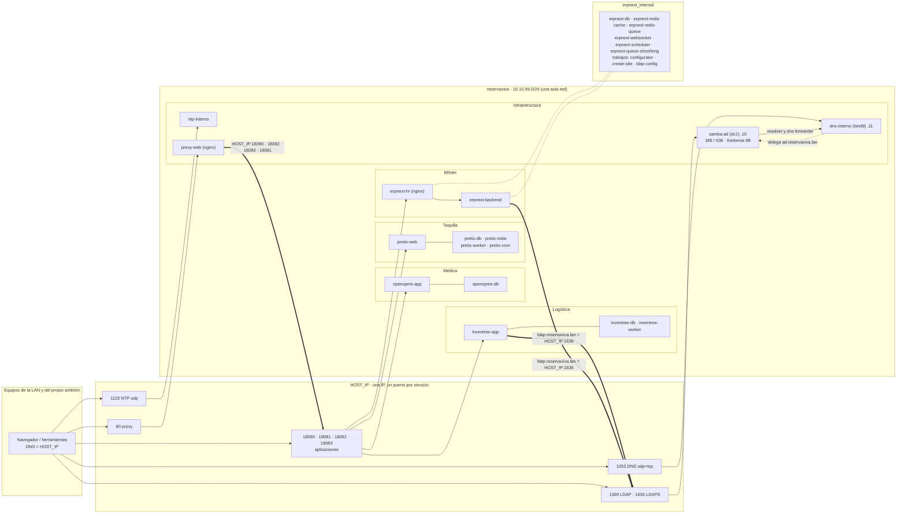

# Arquitectura del sistema en un host

Cómo está montado Reserva Viva: qué contenedores hay, en qué red está cada uno, qué puertos se publican en la IP del
equipo y cómo se hablan entre sí. Es la **referencia de redes y puertos** de la documentación: el resto de documentos enlaza
aquí. Todo sale del [`docker-compose.yml`](../docker-compose.yml) de la raíz y de [`sistema/test.env`](../sistema/test.env);
si algún día difieren de este documento, manda el código.

Otros documentos: las aplicaciones y su primera entrada en [aplicaciones.md](aplicaciones.md); la CA, el directorio, LDAPS, cuentas y
exposición en [seguridad.md](seguridad.md); cómo arrancar, parar y diagnosticar en [operacion.md](operacion.md); las
cifras medidas (tiempos, memoria, PASS/FAIL) en [resultados-un-host.md](resultados-un-host.md).

## 1. Visión general

Todo el sistema corre en **un solo equipo**: Docker Engine dentro de WSL (o Docker Desktop), con un único proyecto de
Compose llamado `reservaviva-smoke` (el nombre es histórico; cambiarlo crearía volúmenes nuevos). Son **26 servicios**
agrupados por departamento:

| Departamento | Aplicación | Servicios |
|---|---|---|
| Unidad Médica Veterinaria | OpenVPMS | 2 |
| Taquilla y Boletería | Pretix | 5 |
| Logística y Almacén | InvenTree | 3 |
| Recursos Humanos | ERPNext (HR) | 12 |
| Infraestructura transversal | Samba AD DC (Kerberos, LDAPS, CA interna), bind9, NTP, proxy web por nombre | 4 |

El switch del laboratorio obliga a **una sola IP (la del equipo, `HOST_IP`) y un puerto distinto por servicio**. Por eso
el sistema tiene **una única red bridge de Docker, `reservaviva`** (más `erpnext_internal`, la red privada de ERPNext), y
**ya no hay segmentación entre departamentos**: todos los contenedores de `reservaviva` se ven entre sí
([seguridad.md](seguridad.md#sin-aislamiento-de-red-entre-departamentos)). Las comunicaciones siguen dos reglas:

- **Dentro de una aplicación**, por el nombre del servicio (`pretix-db`, `pretix-redis`, `inventree-db`, `openvpms-db`).
  Las bases de datos y los Redis **no se publican** en el equipo.
- **Entre aplicaciones distintas**, por `HOST_IP:puerto` publicado: el proxy web llega a las cuatro aplicaciones por
  `HOST_IP:<puerto de cada una>`, e InvenTree y ERPNext llegan al LDAPS de Samba AD por `ldap.reservaviva.lan:LDAPS_PORT`
  (el nombre se resuelve a `HOST_IP` con `extra_hosts`).

`HOST_IP` es una variable de [`sistema/test.env`](../sistema/test.env) (`192.168.1.26` en el laboratorio). El diseño
anterior, con una VLAN por departamento, está en [`diseno-red/`](../diseno-red/README.md) como registro histórico.

## 2. Diagrama

Los contenedores auxiliares (bases de datos, Redis, workers) van agrupados por aplicación. Todos los cuadros están en la
red `reservaviva` salvo los de `erpnext_internal`. Las flechas gruesas son las que cruzan entre aplicaciones y van por
`HOST_IP:puerto`, no por la red de Docker.



Las cuatro aplicaciones se publican además en `127.0.0.1` con el mismo puerto, para entrar por `localhost` desde el propio
equipo.

## 3. Redes

Definidas en la sección `networks:` del compose. La subred se puede cambiar con `NET_INTERNA` (los tres primeros
octetos), solo si choca con otra red del equipo; `sistema/test.env` **no la define**, así que rige el valor por defecto
de la tabla.

| Red | Uso | Subred | Gateway |
|---|---|---|---|
| `reservaviva` | Todos los servicios (la red real del compose se llama `reservaviva-smoke_reservaviva`) | 10.10.99.0/24 | 10.10.99.1 |
| `erpnext_internal` | Red privada de ERPNext (MariaDB, Redis, workers). Solo `erpnext-backend` y `erpnext-hr` están también en `reservaviva` | la asigna Docker | la asigna Docker |

El gateway `.1` es la interfaz del bridge en el equipo anfitrión, no un router. **Solo dos contenedores tienen IP fija**:
`samba-ad` (10.10.99.10) y `dns-interno` (10.10.99.11). El controlador de dominio se provisionó con esa IP (se registra a
sí mismo en el DNS del dominio) y la delegación de `ad.reservaviva.lan` apunta a ella: cambiarla obligaría a
reprovisionar el directorio. El resto recibe IP dinámica y se encuentra por nombre de servicio.

## 4. Servicios

Las imágenes están fijadas por digest en el compose; aquí solo se muestra la etiqueta. IP dinámica = la asigna Docker.

| # | Servicio | Departamento | Contenedor | Redes | IP | Imagen | Carpeta |
|---|---|---|---|---|---|---|---|
| 1 | `openvpms-db` | Médica | `openvpms-db` | reservaviva | dinámica | `mysql:8.0.46` | [openvpms](../servicios/openvpms/README.md) |
| 2 | `openvpms-app` | Médica | `openvpms-app` | reservaviva | dinámica | construida (`build: ./servicios/openvpms`) | [openvpms](../servicios/openvpms/README.md) |
| 3 | `pretix-db` | Taquilla | `pretix-db` | reservaviva | dinámica | `postgres:15.19` | [pretix](../servicios/pretix/README.md) |
| 4 | `pretix-redis` | Taquilla | `pretix-redis` | reservaviva | dinámica | `redis:7.4.11` | [pretix](../servicios/pretix/README.md) |
| 5 | `pretix-web` | Taquilla | `pretix-web` | reservaviva | dinámica | `pretix/standalone:stable` | [pretix](../servicios/pretix/README.md) |
| 6 | `pretix-worker` | Taquilla | `pretix-worker` | reservaviva | dinámica | `pretix/standalone:stable` | [pretix](../servicios/pretix/README.md) |
| 7 | `pretix-cron` | Taquilla | `pretix-cron` | reservaviva | dinámica | `pretix/standalone:stable` | [pretix](../servicios/pretix/README.md) |
| 8 | `inventree-db` | Logística | `inventree-db` | reservaviva | dinámica | `postgres:15.19` | [inventree](../servicios/inventree/README.md) |
| 9 | `inventree-app` | Logística | `inventree-app` | reservaviva | dinámica | `inventree/inventree:1.5.5` | [inventree](../servicios/inventree/README.md) |
| 10 | `inventree-worker` | Logística | `inventree-worker` | reservaviva | dinámica | `inventree/inventree:1.5.5` | [inventree](../servicios/inventree/README.md) |
| 11 | `erpnext-db` | RRHH | `erpnext-db` | erpnext_internal | dinámica | `mariadb:10.6.28` | [erpnext](../servicios/erpnext/README.md) |
| 12 | `erpnext-redis-cache` | RRHH | `erpnext-redis-cache` | erpnext_internal | dinámica | `redis:7.4.11` | [erpnext](../servicios/erpnext/README.md) |
| 13 | `erpnext-redis-queue` | RRHH | `erpnext-redis-queue` | erpnext_internal | dinámica | `redis:7.4.11` | [erpnext](../servicios/erpnext/README.md) |
| 14 | `erpnext-configurator` | RRHH | `erpnext-configurator` | erpnext_internal | dinámica | `ghcr.io/frappe/hrms:v15.64.1` | [erpnext](../servicios/erpnext/README.md) |
| 15 | `erpnext-create-site` | RRHH | `erpnext-create-site` | erpnext_internal | dinámica | `ghcr.io/frappe/hrms:v15.64.1` | [erpnext](../servicios/erpnext/README.md) |
| 16 | `erpnext-ldap-config` | RRHH | `erpnext-ldap-config` | erpnext_internal | dinámica | `ghcr.io/frappe/hrms:v15.64.1` | [erpnext](../servicios/erpnext/README.md) |
| 17 | `erpnext-backend` | RRHH | `erpnext-backend` | reservaviva, erpnext_internal | dinámica | `ghcr.io/frappe/hrms:v15.64.1` | [erpnext](../servicios/erpnext/README.md) |
| 18 | `erpnext-websocket` | RRHH | `erpnext-websocket` | erpnext_internal | dinámica | `ghcr.io/frappe/hrms:v15.64.1` | [erpnext](../servicios/erpnext/README.md) |
| 19 | `erpnext-scheduler` | RRHH | `erpnext-scheduler` | erpnext_internal | dinámica | `ghcr.io/frappe/hrms:v15.64.1` | [erpnext](../servicios/erpnext/README.md) |
| 20 | `erpnext-queue-short` | RRHH | `erpnext-queue-short` | erpnext_internal | dinámica | `ghcr.io/frappe/hrms:v15.64.1` | [erpnext](../servicios/erpnext/README.md) |
| 21 | `erpnext-queue-long` | RRHH | `erpnext-queue-long` | erpnext_internal | dinámica | `ghcr.io/frappe/hrms:v15.64.1` | [erpnext](../servicios/erpnext/README.md) |
| 22 | `erpnext-hr` | RRHH | `erpnext-hr` | reservaviva, erpnext_internal | dinámica | `ghcr.io/frappe/hrms:v15.64.1` | [erpnext](../servicios/erpnext/README.md) |
| 23 | `samba-ad` | Infraestructura | `samba-ad` | reservaviva | 10.10.99.10 | construida (`build: ./servicios/samba-ad`, `debian:trixie` + Samba 4.22) | [samba-ad](../servicios/samba-ad/README.md), [ca](../servicios/ca/README.md) |
| 24 | `dns` | Infraestructura | `dns-interno` | reservaviva | 10.10.99.11 | `internetsystemsconsortium/bind9:9.18` | [bind9](../servicios/bind9/README.md) |
| 25 | `ntp` | Infraestructura | `ntp-interno` | reservaviva | dinámica | `cturra/ntp:latest` | [ntp](../servicios/ntp/README.md) |
| 26 | `proxy` | Infraestructura | `proxy-web` | reservaviva | dinámica | `nginx:1.30.5-alpine` | [proxy](../servicios/proxy/README.md) |

**Trabajos de inicialización.** `erpnext-configurator`, `erpnext-create-site` y `erpnext-ldap-config` tienen
`restart: "no"`: ejecutan su script y terminan en `Exited (0)`, que es su estado correcto. Van encadenados con
`depends_on`: `erpnext-db` sano → `configurator` → `create-site` → `ldap-config`; `erpnext-backend`, `websocket`,
`scheduler` y las dos colas esperan a que `create-site` termine con éxito.

Otras dependencias de arranque: `inventree-app`, `erpnext-backend` y `erpnext-ldap-config` esperan a `samba-ad` sano (`service_healthy`), que solo lo está cuando terminó de sembrar el directorio; `openvpms-app` espera a que `openvpms-db` esté sano; `pretix-worker` y `pretix-cron`, a
`pretix-web` sano (solo `pretix-web` migra la base); `inventree-worker`, a `inventree-app` sano. Los servicios con
healthcheck son las bases de datos y los Redis, `samba-ad`, `openvpms-app`, `pretix-web`, `inventree-app`, `erpnext-hr`, `ntp` y
`proxy-web`. El proxy no depende de ningún servicio: apunta a `HOST_IP:puerto` y, mientras una aplicación arranca, esa
aplicación responde 502.

## 5. Quién habla con quién y por dónde

Con una sola red, la regla no la pone Docker sino el diseño: lo que es de una aplicación se alcanza por nombre de servicio
y lo que cruza entre aplicaciones, por la IP y el puerto publicados.

| Flujo | Cómo |
|---|---|
| Aplicación ↔ su base de datos, Redis o worker | Nombre del servicio dentro de `reservaviva` (`pretix-db:5432`, `pretix-redis`, `inventree-db`, `openvpms-db`). No se publican en el equipo |
| `proxy-web` → las cuatro aplicaciones | `http://HOST_IP:OPENVPMS_PORT`, `PRETIX_PORT`, `INVENTREE_PORT` y `ERPNEXT_PORT` |
| `inventree-app` y `erpnext-backend` → Samba AD | `ldaps://ldap.reservaviva.lan:LDAPS_PORT`, con `extra_hosts` `ldap.reservaviva.lan → HOST_IP` |
| Usuarios → aplicaciones | Por nombre (proxy web en `HOST_IP:80`) o directo en `HOST_IP:<puerto de la aplicación>` |
| Clientes → DNS, NTP, LDAP | `HOST_IP:DNS_PORT`, `HOST_IP:NTP_PORT`, `HOST_IP:LDAP_PORT` / `LDAPS_PORT` |
| `samba-ad` ↔ `dns-interno` | IP fija dentro de `reservaviva` (una delegación DNS no admite puerto) |
| ERPNext: backend, workers y bases | `erpnext_internal`, por nombre de servicio |

`erpnext-backend` y `erpnext-hr` están además en `reservaviva`: el primero para llegar a Samba AD, el segundo porque es el
nginx de ERPNext que atiende a los usuarios y publica `ERPNEXT_PORT`. El resto de ERPNext solo está en `erpnext_internal`.

OpenVPMS y Pretix no usan LDAP ([directorio-activo.md](directorio-activo.md#9-límites-y-decisiones)).

**Lo que esto no aísla:** al estar todos en `reservaviva`, cualquier contenedor alcanza a cualquier otro, y todo lo
publicado es accesible desde la LAN en `HOST_IP`. Está explicado en
[seguridad.md, "Sin aislamiento de red entre departamentos"](seguridad.md#sin-aislamiento-de-red-entre-departamentos).

## 6. Flujos

### Login LDAP de ERPNext e InvenTree

1. El usuario entra en la web de la aplicación (`erpnext-hr` → `erpnext-backend`, o `inventree-app`).
2. La aplicación abre `ldaps://ldap.reservaviva.lan:LDAPS_PORT` (1636). El nombre lo resuelve su `extra_hosts` a
   `HOST_IP`, donde Docker publica el 636 de `samba-ad`. No pasa por bind9.
3. Verifica el certificado del DC con la CA interna montada en `/certs/ca.crt` (desde `servicios/ca/certs/ca.crt`). El
   nombre coincide con el SAN del certificado. Samba exige TLS para el bind simple (`ldap server require strong auth =
   yes`), así que no hay vía por el 389 sin cifrar.
4. Hace bind con la cuenta de servicio `CN=svc-lectura,OU=Servicios,DC=ad,DC=reservaviva,DC=lan`, busca al usuario por
   `sAMAccountName` en todo el dominio con la condición de ser miembro directo de su grupo (`GG-RRHH` para ERPNext,
   `GG-Operaciones` para InvenTree) y después hace bind con la clave del propio usuario.

En ERPNext, `erpnext-ldap-config` solo escribe "LDAP Settings" en la base (como "Active Directory"); no se conecta al DC
y por eso no necesita llegar a la red `reservaviva`. Las tres piezas que usan el directorio (`inventree-app`, `erpnext-backend` y
`erpnext-ldap-config`) esperan a que `samba-ad` esté sano. Detalle y pruebas en
[directorio-activo.md](directorio-activo.md#4-cómo-autentican-inventree-y-erpnext); cuentas y política en
[seguridad.md](seguridad.md#3-directorio-activo-y-ldaps).

### Resolución de nombres: DNS de Docker frente a bind9

- **Ningún servicio define `dns:`** salvo `samba-ad`, así que los contenedores usan el **DNS embebido de Docker**, que
  resuelve los nombres de servicio y de contenedor dentro de cada red compartida. Así se encuentran los componentes de
  ERPNext en `erpnext_internal` y las bases de datos y Redis de Pretix, InvenTree y OpenVPMS en `reservaviva`
  (`pretix-db`, `pretix-redis`, `inventree-db`, `openvpms-db`).
- **bind9 (`dns-interno`, 10.10.99.11)** es el servidor autoritativo de `reservaviva.lan`, con **una sola vista y una sola
  zona** (siguiente apartado) y recursión solo para los contenedores de `reservaviva`, limitada a seguir la delegación de
  `ad.reservaviva.lan` ([`named.conf`](../servicios/bind9/named.conf)). Se publica en `HOST_IP:DNS_PORT` (udp y tcp): lo
  consultan la verificación, el equipo anfitrión y los equipos de la LAN (por el 53, con Docker Engine en WSL a través
  del reenviador de Windows, sección 7). Las aplicaciones no dependen de él. Samba AD sí lo usa: es su resolver (`dns:
  10.10.99.11` en el compose) y a la vez bind9 le delega la zona AD.
- **`extra_hosts`** fija `ldap.reservaviva.lan → HOST_IP` en `inventree-app` y `erpnext-backend`, los dos contenedores
  que hacen LDAPS. Así el nombre coincide con el certificado sin depender de ningún DNS (el certificado lleva además
  `IP:HOST_IP` en su SAN).

### La zona `reservaviva.lan`

El dominio interno es `reservaviva.lan`. Antes era `reservaviva.local`, pero `.local` está reservado a mDNS (RFC 6762):
macOS, Linux con Avahi y los móviles resuelven esos nombres por multicast y no preguntan a este DNS, así que no servía
para entrar desde otros equipos.

Con una sola IP, el mismo nombre lleva al mismo sitio a todos: **`HOST_IP`**. Ya no hay IP de contenedor distinta para
quien pregunta desde dentro. Los clientes que no son un contenedor (el anfitrión y la LAN) no tienen recursión; los
contenedores de la red, sí, pero solo para seguir la delegación de `ad`. La ACL de recursión es la subred de
`reservaviva` **sin el gateway `.1`**: una consulta del anfitrión al puerto publicado llega a bind9 con el gateway del
bridge como origen (así la reenvía Docker), y ese cliente es el anfitrión, no un contenedor.

La plantilla es [`db.reservaviva.lan.tpl`](../servicios/bind9/zones/db.reservaviva.lan.tpl), con `${IP_ANFITRION}` en cada
nombre más la delegación. La función `generar_zona` de [`levantar-sistema.sh`](../levantar-sistema.sh) (acción `preparar`,
y también `arrancar`) sustituye los marcadores por `HOST_IP` y por la fecha (`${SERIAL}`). Escribe, fuera de git,
`servicios/bind9/zones/db.reservaviva.lan` y `acl-interna.conf`, y solo reemplaza un fichero si cambió algo más que el
serial. Si alguno de ellos, o `named.conf`, es más nuevo que el arranque de `dns-interno`, el script reinicia ese
contenedor para que bind9 los lea.

| Nombre | Resuelve a | Servicio |
|---|---|---|
| `dns.reservaviva.lan` | `HOST_IP` | `dns-interno` (`DNS_PORT`) |
| `ldap.reservaviva.lan` | `HOST_IP` | `samba-ad` (`LDAP_PORT` / `LDAPS_PORT`) |
| `ntp.reservaviva.lan` | `HOST_IP` | `ntp-interno` (`NTP_PORT`) |
| `openvpms.reservaviva.lan` | `HOST_IP` | proxy web → `openvpms-app` |
| `pretix.reservaviva.lan` | `HOST_IP` | proxy web → `pretix-web` |
| `inventree.reservaviva.lan` | `HOST_IP` | proxy web → `inventree-app` |
| `rrhh.reservaviva.lan` | `HOST_IP` | proxy web → `erpnext-hr` (nginx, el que atiende HTTP) |
| `ad.reservaviva.lan` (delegación) | `NS dc1.ad.reservaviva.lan.` y glue `dc1.ad` → 10.10.99.10; lo resuelve el propio DC | `samba-ad` |

Un nombre que no existe en la zona da NXDOMAIN; uno de fuera de `reservaviva.lan` da NXDOMAIN a los contenedores y REFUSED al anfitrión y a la LAN, nunca una IP real.

### Delegación de `ad.reservaviva.lan` a Samba AD

El directorio vive en el subdominio `ad.reservaviva.lan` y su DNS lo sirve el propio DC (Samba, `SAMBA_INTERNAL`). bind9 no
lo reenvía con una zona `forward`: como es autoritativo del padre, `reservaviva.lan`, esa zona nunca se consultaría.
Lo que hay es una **delegación NS con glue** dentro de la zona (`ad IN NS dc1.ad.reservaviva.lan.` y
`dc1.ad IN A 10.10.99.10`). Para seguirla, bind9 lleva `recursion yes` limitada a los contenedores de la red, y una raíz
`"."` autoritativa y vacía (`zones/db.raiz-vacia`): todo nombre que no sea de `reservaviva.lan` da NXDOMAIN por política, tenga o no salida el host.
(Una zona `"."` de reenvío con `forwarders { }` no sirve: BIND desactiva el reenvío y recursiona con sus root hints.) Samba reenvía a
bind9 (`dns forwarder = 10.10.99.11`) lo que no es de su zona. Razones y comprobación en
[`servicios/bind9/README.md`](../servicios/bind9/README.md) y [directorio-activo.md](directorio-activo.md#2-realm-dns-y-delegación).

`levantar-sistema.sh verificar` comprueba que cada nombre de la zona apunta a `HOST_IP`, consultando a `HOST_IP:DNS_PORT`
([`verificar_arquitectura.md`](../sistema/verificar_arquitectura.md)).

### Acceso por nombre: el proxy web

`proxy-web` (nginx, [`servicios/proxy/`](../servicios/proxy/README.md)) atiende en `HOST_IP:HTTP_PORT` (80) y reparte
por el nombre pedido hacia el puerto publicado de cada aplicación: `openvpms.reservaviva.lan` →
`http://HOST_IP:OPENVPMS_PORT` (la raíz redirige a `/openvpms/`), `pretix.reservaviva.lan` → `HOST_IP:PRETIX_PORT`,
`inventree.reservaviva.lan` → `HOST_IP:INVENTREE_PORT` y `rrhh.reservaviva.lan` → `HOST_IP:ERPNEXT_PORT`. Otro nombre, o la
IP a secas, recibe un 404 que lo explica. Pasa el `Host` original y las cabeceras `X-Forwarded-*`, admite WebSocket (el
tiempo real de ERPNext) y subidas de hasta 50 MB.

Un navegador llega así: pregunta `pretix.reservaviva.lan` al DNS del sistema → recibe `HOST_IP` → abre el puerto 80 → el
proxy lo manda a `HOST_IP:PRETIX_PORT`.

Pretix e InvenTree tienen como URL propia su nombre (`PRETIX_PRETIX_URL=http://pretix.reservaviva.lan`,
`INVENTREE_SITE_URL=http://inventree.reservaviva.lan`), y el acceso directo por `localhost` sigue funcionando: Pretix
admite siempre el `Host` `localhost` además del de su URL, e InvenTree tiene `http://localhost:<INVENTREE_PORT>` y
`http://HOST_IP:<INVENTREE_PORT>` como orígenes de confianza (`INVENTREE_TRUSTED_ORIGINS`), que es lo que su interfaz `/web` exige para no responder 500
(INVE-E7). ERPNext elige el sitio por la cabecera fija `FRAPPE_SITE_NAME_HEADER`, no por el `Host`, y OpenVPMS no
comprueba el `Host`.

### Identificadores con el sufijo antiguo

El cambio a `reservaviva.lan` afecta a nombres DNS, URL y certificados. Estos otros identificadores **conservan
`reservaviva.local` a propósito**, porque están guardados en los datos persistentes (volúmenes) y cambiarlos obligaría a
migrar o reinicializar bases. No son nombres DNS: nadie los resuelve.

El directorio ya no está en la lista: el DN de Samba AD es `DC=ad,DC=reservaviva,DC=lan` y el `mail` de las cuentas de
prueba termina en `reservaviva.lan`, porque Samba no admite `.local`. Lo que queda con el sufijo antiguo, aparte de los
de la tabla, es un User huérfano en la base de ERPNext (`rrhh.prueba@reservaviva.local`, del stack anterior con OpenLDAP;
inofensivo, se borra a mano), descrito en
[directorio-activo.md](directorio-activo.md#quien-venía-del-stack-viejo-limpiar-los-restos).

| Identificador | Dónde vive | Por qué no cambia |
|---|---|---|
| Sitio de ERPNext `rrhh.reservaviva.local` (`ERPNEXT_SITE`, `FRAPPE_SITE_NAME_HEADER`) | Carpeta `sites/` (volumen `erpnext_sites`) y nombre de la base de MariaDB | Es el nombre interno del sitio de Frappe; nginx lo elige por cabecera, no por el `Host` |
| Administrador de Pretix `admin@reservaviva.local` (`PRETIX_ADMIN_EMAIL`) | Base de datos de Pretix | Es su usuario de entrada; `crear_admin_pretix` lo busca por ese correo |
| Correo del administrador de InvenTree `admin@reservaviva.local` (`INVENTREE_ADMIN_EMAIL`) | Base de datos de InvenTree | El superusuario ya existe con ese correo |

El remitente de Pretix (`PRETIX_MAIL_FROM`) sí pasó a `taquilla@reservaviva.lan`: es configuración, no un dato guardado.

### NTP

`ntp-interno` (imagen `cturra/ntp`) sirve su propio reloj con stratum 10, sin salida a Internet
(`NTP_SERVERS: "127.127.1.1"`; el porqué está en el compose y en [su README](../servicios/ntp/README.md)). Se publica en
`HOST_IP:NTP_PORT` (udp). Ningún servicio del compose está configurado como cliente suyo. Quien lo usa es la
verificación, con un cliente SNTP y un cliente chrony real.

## 7. Puertos publicados

Valores de [`sistema/test.env`](../sistema/test.env). **Todo se publica en `HOST_IP`**, la IP del equipo (`192.168.1.26`
en el laboratorio): las cuatro aplicaciones, el proxy web, LDAP/LDAPS, el DNS y el NTP. Ya no existe un modo local frente
a un modo intranet, y por tanto todo es accesible desde la LAN. Los puertos del host están desplazados porque OpenVPMS y
ERPNext escuchan ambos en 8080, y 53/udp y 123/udp suelen estar ocupados en Windows.

`--ip X` (`-IP X` en PowerShell) sustituye `HOST_IP` solo en esa ejecución, sin tocar `test.env` (en compose, el entorno
manda sobre `--env-file`); `--intranet` (`-Intranet`) autodetecta la IP de la LAN. El equipo debe tener esa IP en una
interfaz: si no, el arranque falla con un mensaje que indica `--ip`.

Con **Docker Engine en WSL** (`networkingMode=mirrored`) `DNS_PORT` es 1053, no 53: Windows no entrega a Linux el tráfico
de su puerto 53, así que bind9 se publica en `HOST_IP:1053` y un proceso de Windows,
[`sistema/reenviador-dns.ps1`](../sistema/reenviador-dns.ps1), escucha en `HOST_IP:53` (UDP y TCP) y reenvía cada
consulta al 1053. El reenviador existe siempre que `DNS_PORT` no sea 53; lo arranca y lo para `levantar-sistema.ps1`, y los
clientes solo ven el 53. Con Docker Desktop o en Linux nativo con `DNS_PORT=53`, bind9 va directo. Cómo se activa y qué
requiere Windows: [operacion.md](operacion.md#acceso-desde-la-lan).

| Servicio (contenedor) | Puerto del host | Puerto del contenedor | Dirección | Variable |
|---|---|---|---|---|
| OpenVPMS (`openvpms-app`) | 18080 (`/openvpms`) | 8080 | `HOST_IP` y `127.0.0.1` | `OPENVPMS_PORT` |
| ERPNext (`erpnext-hr`) | 18081 | 8080 | `HOST_IP` y `127.0.0.1` | `ERPNEXT_PORT` |
| Pretix (`pretix-web`) | 18082 | 80 | `HOST_IP` y `127.0.0.1` | `PRETIX_PORT` |
| InvenTree (`inventree-app`) | 18083 | 8000 | `HOST_IP` y `127.0.0.1` | `INVENTREE_PORT` |
| Samba AD, LDAP (`samba-ad`; el bind simple se rechaza: exige TLS) | 1389 | 389 | `HOST_IP` | `LDAP_PORT` |
| Samba AD, LDAPS (`samba-ad`) | 1636 | 636 | `HOST_IP` | `LDAPS_PORT` |
| bind9 (`dns-interno`) | 1053 udp y tcp (el 53 de la LAN lo atiende el reenviador de Windows) | 53 | `HOST_IP` | `DNS_PORT` |
| NTP (`ntp-interno`) | 1123 udp | 123 | `HOST_IP` | `NTP_PORT` |
| Proxy web por nombre (`proxy-web`) | 80 | 80 | `HOST_IP` | `HTTP_PORT` |

Ningún otro contenedor publica puertos: `erpnext-backend` (gunicorn, 8000) y las bases de datos solo son alcanzables
desde sus redes. `samba-ad` **no publica** el 445 (SMB, lo ocupa Windows en el host), el 88 (Kerberos, se prueba dentro de la
red) ni el 53 (el DNS llega por bind9).

**Si faltara una variable**, `HOST_IP` es obligatoria: el compose se niega a arrancar con el mensaje «definir HOST_IP en
sistema/test.env». Los puertos usan sus valores originales por defecto (8080, 8080, 80, 8000, 389, 636, 53 y 123), con los
que OpenVPMS y ERPNext chocarían en el 8080. Hay que arrancar siempre con `--env-file sistema/test.env`, como hace
`levantar-sistema`.

Las URL propias de Pretix e InvenTree (`PRETIX_PRETIX_URL`, `INVENTREE_SITE_URL`) son su nombre en `reservaviva.lan`, y
las dos admiten además el acceso directo por `localhost` (sección 6, "Acceso por nombre"). Por `HOST_IP:PRETIX_PORT` y por `127.0.0.1` Pretix sigue
respondiendo 400 ([aplicaciones.md](aplicaciones.md)).

## 8. Estructura del repositorio

```
docker-compose.yml         el único compose: 26 servicios, 2 redes y los volúmenes
servicios/
  openvpms/                Dockerfile propio, entrypoint reanudable y su prueba
  pretix/                  solo README (configuración en el compose)
  inventree/               solo README (configuración en el compose)
  erpnext/                 prueba de erpnext-create-site
  samba-ad/                Dockerfile, entrypoint (provisión) y siembra del directorio
  ca/                      generar-certificados.sh; certs/ (fuera de git)
  bind9/                   named.conf (una vista) y plantilla de la zona
  ntp/                     solo README
  proxy/                   plantilla de configuración de nginx (proxy web por nombre)
sistema/                   test.env (variables), scripts de verificación y de Windows para abrirlo a la LAN
levantar-sistema.sh        arranque, preparación, estado, verificación (.ps1 y .cmd: lanzadores desde Windows)
docs/                      documentación (este documento, aplicaciones, seguridad, operación, directorio activo, resultados)
diseno-red/                HISTÓRICO: diseño de 3 equipos con VLAN 802.1Q, sustituido el 04/10/2026 (no se despliega)
```

## 9. Diferencias con el diseño original (histórico)

El diseño de la Entrega 1 está conservado como registro en [`diseno-red/`](../diseno-red/README.md)
([`arquitectura-3-equipos-departamentos.md`](../diseno-red/arquitectura-3-equipos-departamentos.md)): PC-1 con Médica, PC-2
con Taquilla y Logística, y PC-3 con RRHH e infraestructura, unidos por un switch con VLAN 802.1Q. **El 04/10/2026 se
sustituyó** porque el switch del laboratorio obliga a una IP y un puerto por servicio. Lo que cambia respecto a ese diseño:

- **Sin VLAN ni segmentación.** Una sola red de Docker; no hay matriz de firewall ni aislamiento entre departamentos.
- **Una IP, un puerto por servicio.** Los servicios de aplicaciones distintas se hablan por `HOST_IP:puerto`, no por la red.
- **Direcciones.** En el diseño, `10.10.99.10` es PC-3 y da LDAP, DNS y NTP a la vez. Aquí `10.10.99.10` es el controlador
  de dominio `samba-ad` y solo él y `dns-interno` (10.10.99.11) tienen IP fija; el resto se alcanza por nombre de servicio
  o por `HOST_IP:puerto`.
- **Una sola CA** montada desde `servicios/ca/certs/`, en lugar de una copia por equipo.
