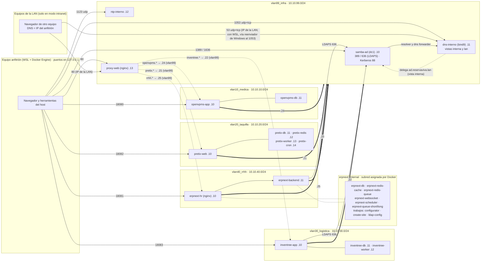

# Arquitectura del sistema en un host

Cómo está montado Reserva Viva: qué contenedores hay, en qué red está cada uno, con qué IP, qué puertos se publican y
cómo se hablan entre sí. Es la **referencia de IP, redes y puertos** de la documentación: el resto de documentos enlaza
aquí. Todo sale del [`docker-compose.yml`](../docker-compose.yml) de la raíz y de [`sistema/test.env`](../sistema/test.env);
si algún día difieren de este documento, manda el código.

Otros documentos: las aplicaciones y su primera entrada en [aplicaciones.md](aplicaciones.md); la CA, el directorio, LDAPS, cuentas y
exposición en [seguridad.md](seguridad.md); cómo arrancar, parar y diagnosticar en [operacion.md](operacion.md); las
cifras medidas (tiempos, memoria, PASS/FAIL) en [resultados-un-host.md](resultados-un-host.md).

## 1. Visión general

Todo el sistema corre en **un solo equipo**: Docker Engine dentro de WSL (o Docker Desktop), con un único proyecto de
Compose llamado `reservaviva-smoke` (el nombre es histórico; cambiarlo crearía volúmenes nuevos). Son **26 servicios**
agrupados por departamento:

| Departamento | VLAN | Aplicación | Servicios |
|---|---|---|---|
| Unidad Médica Veterinaria | 10 | OpenVPMS | 2 |
| Taquilla y Boletería | 20 | Pretix | 5 |
| Logística y Almacén | 30 | InvenTree | 3 |
| Recursos Humanos | 40 | ERPNext (HR) | 12 |
| Infraestructura transversal | 99 | Samba AD DC (Kerberos, LDAPS, CA interna), bind9, NTP, proxy web por nombre | 4 |

Cada VLAN del diseño es una **red bridge de Docker con su misma subred**. Dos bridges no se enrutan entre sí: esa es la
segmentación. La aplicación de cada departamento está además en `vlan99_infra` para llegar a la infraestructura, y por
esa misma red la sirve el proxy web con su nombre en el dominio interno `reservaviva.lan` (sección 6).

## 2. Diagrama

Los contenedores auxiliares (bases de datos, Redis, workers) van agrupados por aplicación. Las flechas hacia
`vlan99_infra` son la **segunda interfaz** del mismo contenedor, con su IP en esa red. Las flechas punteadas del proxy
web van siempre por esa segunda interfaz: el proxy solo está en `vlan99_infra`.



En modo local (el de por defecto) el proxy y el DNS se publican en `127.0.0.1`, como todo lo demás; en modo intranet
(`levantar-sistema --intranet`) solo esos dos pasan a la IP de la LAN (sección 7).

## 3. Redes

Definidas en la sección `networks:` del compose. La subred de cada VLAN se puede cambiar con `NET_MEDICA`,
`NET_TAQUILLA`, `NET_LOGISTICA`, `NET_RRHH` y `NET_INFRA` (los tres primeros octetos), solo si choca con otra red del
equipo; `sistema/test.env` **no las define**, así que rigen los valores por defecto de la tabla.

| Red | Uso | Subred | Gateway |
|---|---|---|---|
| `vlan10_medica` | Unidad Médica Veterinaria (OpenVPMS) | 10.10.10.0/24 | 10.10.10.1 |
| `vlan20_taquilla` | Taquilla y Boletería (Pretix) | 10.10.20.0/24 | 10.10.20.1 |
| `vlan30_logistica` | Logística y Almacén (InvenTree) | 10.10.30.0/24 | 10.10.30.1 |
| `vlan40_rrhh` | Recursos Humanos (ERPNext) | 10.10.40.0/24 | 10.10.40.1 |
| `vlan99_infra` | Infraestructura: Samba AD, DNS, NTP, el proxy web y la segunda interfaz de cada aplicación | 10.10.99.0/24 | 10.10.99.1 |
| `erpnext_internal` | Red privada de ERPNext (MariaDB, Redis, workers). No es una VLAN del diseño | la asigna Docker | la asigna Docker |

El gateway `.1` es la interfaz del bridge en el equipo anfitrión, no un router entre VLAN.

## 4. Servicios

Las imágenes están fijadas por digest en el compose; aquí solo se muestra la etiqueta. `.x` = IP dinámica asignada por
Docker en `erpnext_internal`.

| # | Servicio | Departamento | Contenedor | Redes | IP fija | Imagen | Carpeta |
|---|---|---|---|---|---|---|---|
| 1 | `openvpms-db` | Médica | `openvpms-db` | vlan10 | 10.10.10.11 | `mysql:8.0.46` | [openvpms](../servicios/openvpms/README.md) |
| 2 | `openvpms-app` | Médica | `openvpms-app` | vlan10, vlan99 | 10.10.10.10 · 10.10.99.24 | construida (`build: ./servicios/openvpms`) | [openvpms](../servicios/openvpms/README.md) |
| 3 | `pretix-db` | Taquilla | `pretix-db` | vlan20 | 10.10.20.11 | `postgres:15.19` | [pretix](../servicios/pretix/README.md) |
| 4 | `pretix-redis` | Taquilla | `pretix-redis` | vlan20 | 10.10.20.12 | `redis:7.4.11` | [pretix](../servicios/pretix/README.md) |
| 5 | `pretix-web` | Taquilla | `pretix-web` | vlan20, vlan99 | 10.10.20.10 · 10.10.99.21 | `pretix/standalone:stable` | [pretix](../servicios/pretix/README.md) |
| 6 | `pretix-worker` | Taquilla | `pretix-worker` | vlan20 | 10.10.20.13 | `pretix/standalone:stable` | [pretix](../servicios/pretix/README.md) |
| 7 | `pretix-cron` | Taquilla | `pretix-cron` | vlan20 | 10.10.20.14 | `pretix/standalone:stable` | [pretix](../servicios/pretix/README.md) |
| 8 | `inventree-db` | Logística | `inventree-db` | vlan30 | 10.10.30.11 | `postgres:15.19` | [inventree](../servicios/inventree/README.md) |
| 9 | `inventree-app` | Logística | `inventree-app` | vlan30, vlan99 | 10.10.30.10 · 10.10.99.22 | `inventree/inventree:1.5.5` | [inventree](../servicios/inventree/README.md) |
| 10 | `inventree-worker` | Logística | `inventree-worker` | vlan30 | 10.10.30.12 | `inventree/inventree:1.5.5` | [inventree](../servicios/inventree/README.md) |
| 11 | `erpnext-db` | RRHH | `erpnext-db` | erpnext_internal | .x | `mariadb:10.6.28` | [erpnext](../servicios/erpnext/README.md) |
| 12 | `erpnext-redis-cache` | RRHH | `erpnext-redis-cache` | erpnext_internal | .x | `redis:7.4.11` | [erpnext](../servicios/erpnext/README.md) |
| 13 | `erpnext-redis-queue` | RRHH | `erpnext-redis-queue` | erpnext_internal | .x | `redis:7.4.11` | [erpnext](../servicios/erpnext/README.md) |
| 14 | `erpnext-configurator` | RRHH | `erpnext-configurator` | erpnext_internal | .x | `ghcr.io/frappe/hrms:v15.64.1` | [erpnext](../servicios/erpnext/README.md) |
| 15 | `erpnext-create-site` | RRHH | `erpnext-create-site` | erpnext_internal | .x | `ghcr.io/frappe/hrms:v15.64.1` | [erpnext](../servicios/erpnext/README.md) |
| 16 | `erpnext-ldap-config` | RRHH | `erpnext-ldap-config` | erpnext_internal | .x | `ghcr.io/frappe/hrms:v15.64.1` | [erpnext](../servicios/erpnext/README.md) |
| 17 | `erpnext-backend` | RRHH | `erpnext-backend` | erpnext_internal, vlan40, vlan99 | .x · 10.10.40.11 · 10.10.99.23 | `ghcr.io/frappe/hrms:v15.64.1` | [erpnext](../servicios/erpnext/README.md) |
| 18 | `erpnext-websocket` | RRHH | `erpnext-websocket` | erpnext_internal | .x | `ghcr.io/frappe/hrms:v15.64.1` | [erpnext](../servicios/erpnext/README.md) |
| 19 | `erpnext-scheduler` | RRHH | `erpnext-scheduler` | erpnext_internal | .x | `ghcr.io/frappe/hrms:v15.64.1` | [erpnext](../servicios/erpnext/README.md) |
| 20 | `erpnext-queue-short` | RRHH | `erpnext-queue-short` | erpnext_internal | .x | `ghcr.io/frappe/hrms:v15.64.1` | [erpnext](../servicios/erpnext/README.md) |
| 21 | `erpnext-queue-long` | RRHH | `erpnext-queue-long` | erpnext_internal | .x | `ghcr.io/frappe/hrms:v15.64.1` | [erpnext](../servicios/erpnext/README.md) |
| 22 | `erpnext-hr` | RRHH | `erpnext-hr` | erpnext_internal, vlan40, vlan99 | .x · 10.10.40.10 · 10.10.99.25 | `ghcr.io/frappe/hrms:v15.64.1` | [erpnext](../servicios/erpnext/README.md) |
| 23 | `samba-ad` | Infraestructura | `samba-ad` | vlan99 | 10.10.99.10 | construida (`build: ./servicios/samba-ad`, `debian:trixie` + Samba 4.22) | [samba-ad](../servicios/samba-ad/README.md), [ca](../servicios/ca/README.md) |
| 24 | `dns` | Infraestructura | `dns-interno` | vlan99 | 10.10.99.11 | `internetsystemsconsortium/bind9:9.18` | [bind9](../servicios/bind9/README.md) |
| 25 | `ntp` | Infraestructura | `ntp-interno` | vlan99 | 10.10.99.12 | `cturra/ntp:latest` | [ntp](../servicios/ntp/README.md) |
| 26 | `proxy` | Infraestructura | `proxy-web` | vlan99 | 10.10.99.13 | `nginx:1.30.5-alpine` | [proxy](../servicios/proxy/README.md) |

**Trabajos de inicialización.** `erpnext-configurator`, `erpnext-create-site` y `erpnext-ldap-config` tienen
`restart: "no"`: ejecutan su script y terminan en `Exited (0)`, que es su estado correcto. Van encadenados con
`depends_on`: `erpnext-db` sano → `configurator` → `create-site` → `ldap-config`; `erpnext-backend`, `websocket`,
`scheduler` y las dos colas esperan a que `create-site` termine con éxito.

Otras dependencias de arranque: `inventree-app`, `erpnext-backend` y `erpnext-ldap-config` esperan a `samba-ad` sano (`service_healthy`), que solo lo está cuando terminó de sembrar el directorio; `openvpms-app` espera a que `openvpms-db` esté sano; `pretix-worker` y `pretix-cron`, a
`pretix-web` sano (solo `pretix-web` migra la base); `inventree-worker`, a `inventree-app` sano. Los servicios con
healthcheck son las bases de datos y los Redis, `samba-ad`, `openvpms-app`, `pretix-web`, `inventree-app`, `erpnext-hr`, `ntp` y
`proxy-web`. El proxy no depende de ningún servicio: apunta a IP literales y, mientras una aplicación arranca, esa
aplicación responde 502.

## 5. Doble conexión: aplicación ↔ vlan99_infra

Samba AD, bind9 y NTP viven en `vlan99_infra`, y entre bridges no hay enrutamiento. Por eso el contenedor de cada
aplicación que necesita la infraestructura tiene **dos interfaces**: una en la VLAN de su departamento y otra en
`vlan99_infra` con IP fija (`openvpms-app` .24, `pretix-web` .21, `inventree-app` .22, `erpnext-backend` .23). En ERPNext
la doble conexión para LDAP la tiene `erpnext-backend`, que es quien habla con Samba AD. `erpnext-hr` (nginx) tiene
también una pata en `vlan99_infra` (.25), pero en sentido contrario: es por donde le llega el proxy web, porque es el
único contenedor de RRHH que sirve la web completa (`/assets`, socket.io y el backend). Los contenedores auxiliares
(bases de datos, Redis, workers) solo están en su red y no llegan a la infraestructura.

El **proxy web** (`proxy-web`, .13) está **solo** en `vlan99_infra`. Conectado a una VLAN de departamento sería un router
entre departamentos; así, lo único que añade es una entrada HTTP por nombre a las aplicaciones, por la misma red por la
que ellas ya llegan a la infraestructura.

OpenVPMS y Pretix no usan LDAP ([directorio-activo.md](directorio-activo.md#9-límites-y-decisiones)), pero conservan la pata en
`vlan99_infra` para llegar a DNS y NTP, igual que en el diseño.

**Lo que un solo host no aísla:** `vlan99_infra` es un único dominio L2 compartido por las cuatro aplicaciones, así que
se alcanzan entre sí por su IP de infraestructura. Está explicado en
[seguridad.md, "Qué no aísla un solo host"](seguridad.md#qué-no-aísla-un-solo-host-limitación-conocida), y la
comprobación que lo muestra, en [`verificar_arquitectura.md`](../sistema/verificar_arquitectura.md).

## 6. Flujos

### Login LDAP de ERPNext e InvenTree

1. El usuario entra en la web de la aplicación (`erpnext-hr` → `erpnext-backend`, o `inventree-app`).
2. La aplicación abre `ldaps://ldap.reservaviva.lan:636`. El nombre lo resuelve su `extra_hosts` a `10.10.99.10`
   (`samba-ad`), y el tráfico sale por su interfaz en `vlan99_infra`. No pasa por bind9.
3. Verifica el certificado del DC con la CA interna montada en `/certs/ca.crt` (desde `servicios/ca/certs/ca.crt`). El
   nombre coincide con el SAN del certificado. Samba exige TLS para el bind simple (`ldap server require strong auth =
   yes`), así que no hay vía por el 389 sin cifrar.
4. Hace bind con la cuenta de servicio `CN=svc-lectura,OU=Servicios,DC=ad,DC=reservaviva,DC=lan`, busca al usuario por
   `sAMAccountName` en todo el dominio con la condición de ser miembro directo de su grupo (`GG-RRHH` para ERPNext,
   `GG-Operaciones` para InvenTree) y después hace bind con la clave del propio usuario.

En ERPNext, `erpnext-ldap-config` solo escribe "LDAP Settings" en la base (como "Active Directory"); no se conecta al DC
y por eso no necesita `vlan99_infra`. Las tres piezas que usan el directorio (`inventree-app`, `erpnext-backend` y
`erpnext-ldap-config`) esperan a que `samba-ad` esté sano. Detalle y pruebas en
[directorio-activo.md](directorio-activo.md#4-cómo-autentican-inventree-y-erpnext); cuentas y política en
[seguridad.md](seguridad.md#3-directorio-activo-y-ldaps).

### Resolución de nombres: DNS de Docker frente a bind9

- **Ningún servicio define `dns:`** en el compose, así que todos los contenedores usan el **DNS embebido de Docker**, que
  resuelve los nombres de servicio y de contenedor dentro de cada red compartida. Así se encuentran los componentes de
  ERPNext en `erpnext_internal` (`erpnext-db`, `erpnext-redis-cache`, `erpnext-redis-queue`, `erpnext-backend:8000`,
  `erpnext-websocket:9000`). Pretix, InvenTree y OpenVPMS llegan a su base y a Redis por **IP fija**.
- **bind9 (`dns-interno`, 10.10.99.11)** es el servidor autoritativo de `reservaviva.lan`, con dos vistas (siguiente
  apartado) y recursión solo en la vista interna, limitada a seguir la delegación de `ad.reservaviva.lan`
  ([`named.conf`](../servicios/bind9/named.conf)). Lo consultan la verificación
  (desde `vlan99_infra`, desde las aplicaciones y desde el anfitrión), el equipo anfitrión por `localhost:1053` y, en modo
  intranet, los equipos de la LAN por el 53 (con Docker Engine en WSL, a través del reenviador de Windows, sección 7).
  Las aplicaciones no dependen de él. Solo es cliente de bind9 quien está en `vlan99_infra`: los departamentos no llegan
  a él (segmentación). Samba AD sí lo usa: es su resolver (`dns: 10.10.99.11` en el compose) y a la vez bind9 le delega
  la zona AD.
- **`extra_hosts`** fija `ldap.reservaviva.lan → 10.10.99.10` (`samba-ad`) en `inventree-app` y `erpnext-backend`, los dos
  contenedores que hacen LDAPS. Así el nombre coincide con el certificado sin depender de ningún DNS.

### La zona `reservaviva.lan` y sus dos vistas

El dominio interno es `reservaviva.lan`. Antes era `reservaviva.local`, pero `.local` está reservado a mDNS (RFC 6762):
macOS, Linux con Avahi y los móviles resuelven esos nombres por multicast y no preguntan a este DNS, así que no servía
para entrar desde otros equipos.

El mismo nombre tiene que llevar a sitios distintos según quién pregunte: un contenedor de una VLAN llega a la IP de otro
contenedor, pero un equipo de la LAN no puede llegar a `10.10.x` y tiene que ir al proxy web del anfitrión. Por eso
bind9 sirve la zona con **dos vistas** (split horizon):

- **`interna`**: los clientes de las subredes de las VLAN, **sin** su gateway `.1`. Reciben la IP del contenedor, como en
  el diseño.
- **`lan`**: cualquier otro cliente, es decir, el anfitrión y los equipos de la LAN. Las aplicaciones y el DNS apuntan a
  `IP_ANFITRION`, la IP en la que se publica el proxy web (`INTRANET_IP`): `127.0.0.1` en modo local y la IP de la LAN en
  modo intranet.

El gateway `.1` queda fuera de la vista interna a propósito: una consulta del anfitrión al puerto publicado llega a
bind9 con el gateway del bridge como origen (así la reenvía Docker), y ese cliente es el anfitrión, no un contenedor.

Las plantillas son [`db.reservaviva.lan.tpl`](../servicios/bind9/zones/db.reservaviva.lan.tpl) (vista interna, un
marcador por nombre: `${IP_DNS}`, `${IP_LDAP}`…) y
[`db.reservaviva.lan.vista-lan.tpl`](../servicios/bind9/zones/db.reservaviva.lan.vista-lan.tpl) (vista lan,
`${IP_ANFITRION}`). La función `generar_zona` de [`levantar-sistema.sh`](../levantar-sistema.sh) (acción `preparar`, y
también `arrancar`) sustituye los marcadores por la IP fija de cada contenedor, con las mismas `NET_*` y valores por
defecto que el compose, por la IP del anfitrión y por la fecha (`${SERIAL}`). Escribe, fuera de git,
`servicios/bind9/zones/db.reservaviva.lan`, `db.reservaviva.lan.vista-lan` y `acl-interna.conf` (las subredes de la
vista interna), y solo reemplaza un fichero si cambió algo más que el serial. Si alguno de ellos, o `named.conf`, es más
nuevo que el arranque de `dns-interno`, el script reinicia ese contenedor para que bind9 los lea.

| Nombre | Vista interna (contenedores) | Contenedor | Vista lan (anfitrión y LAN) |
|---|---|---|---|
| `dns.reservaviva.lan` | 10.10.99.11 | `dns-interno` | `IP_ANFITRION` |
| `ldap.reservaviva.lan` | 10.10.99.10 | `samba-ad` | no existe (NXDOMAIN) |
| `ad.reservaviva.lan` (delegación) | `NS dc1.ad.reservaviva.lan.` y glue `dc1.ad` → 10.10.99.10; lo resuelve el propio DC | `samba-ad` | no existe (NXDOMAIN) |
| `ntp.reservaviva.lan` | 10.10.99.12 | `ntp-interno` | no existe (NXDOMAIN) |
| `openvpms.reservaviva.lan` | 10.10.10.10 | `openvpms-app` | `IP_ANFITRION` (proxy web) |
| `pretix.reservaviva.lan` | 10.10.20.10 | `pretix-web` | `IP_ANFITRION` (proxy web) |
| `inventree.reservaviva.lan` | 10.10.30.10 | `inventree-app` | `IP_ANFITRION` (proxy web) |
| `rrhh.reservaviva.lan` | 10.10.40.10 | `erpnext-hr` (nginx, el que atiende HTTP) | `IP_ANFITRION` (proxy web) |

`ldap` y `ntp` no se anuncian en la vista lan porque Samba AD y NTP solo se publican en `127.0.0.1` y en puertos
desplazados: un nombre que llevara a la IP de la LAN llevaría a un puerto cerrado. Por la misma razón la vista lan no
lleva la delegación de `ad.reservaviva.lan`.

### Delegación de `ad.reservaviva.lan` a Samba AD

El directorio vive en el subdominio `ad.reservaviva.lan` y su DNS lo sirve el propio DC (Samba, `SAMBA_INTERNAL`). bind9 no
lo reenvía con una zona `forward`: como es autoritativo del padre, `reservaviva.lan`, esa zona nunca se consultaría.
Lo que hay es una **delegación NS con glue** dentro de la zona, solo en la vista interna (`ad IN NS dc1.ad.reservaviva.lan.`
y `dc1.ad IN A 10.10.99.10`). Para seguirla, esa vista lleva `recursion yes` limitada a `red-interna`, y una zona `"."`
de reenvío sin reenviadores: todo nombre que no sea de `reservaviva.lan` da `SERVFAIL` por política. Samba reenvía a
bind9 (`dns forwarder = 10.10.99.11`) lo que no es de su zona. Razones y comprobación en
[`servicios/bind9/README.md`](../servicios/bind9/README.md) y [directorio-activo.md](directorio-activo.md#2-realm-dns-y-delegación).

`levantar-sistema.sh verificar` comprueba que cada nombre de la vista interna apunta a la IP real del contenedor y que la
vista lan da la IP del proxy ([`verificar_arquitectura.md`](../sistema/verificar_arquitectura.md), bloques 2 y 4).

### Acceso por nombre: el proxy web

`proxy-web` (nginx, [`servicios/proxy/`](../servicios/proxy/README.md)) atiende en el puerto 80 del anfitrión y reparte
por el nombre pedido: `openvpms.reservaviva.lan` → `openvpms-app` (`10.10.99.24:8080`; la raíz redirige a `/openvpms/`),
`pretix.reservaviva.lan` → `pretix-web` (`.21:80`), `inventree.reservaviva.lan` → `inventree-app` (`.22:8000`) y
`rrhh.reservaviva.lan` → `erpnext-hr` (`.25:8080`). Otro nombre, o la IP a secas, recibe un 404 que lo explica. Pasa el
`Host` original y las cabeceras `X-Forwarded-*`, admite WebSocket (el tiempo real de ERPNext) y subidas de hasta 50 MB.

Un navegador de la LAN llega así: pregunta `pretix.reservaviva.lan` al DNS del anfitrión (vista lan) → recibe la IP del
anfitrión → abre el puerto 80 → el proxy lo manda a `10.10.99.21` por `vlan99_infra`.

Pretix e InvenTree tienen como URL propia su nombre (`PRETIX_PRETIX_URL=http://pretix.reservaviva.lan`,
`INVENTREE_SITE_URL=http://inventree.reservaviva.lan`), y el acceso directo por `localhost` sigue funcionando: Pretix
admite siempre el `Host` `localhost` además del de su URL, e InvenTree tiene `http://localhost:<INVENTREE_PORT>` como
segundo origen de confianza (`INVENTREE_TRUSTED_ORIGINS`), que es lo que su interfaz `/web` exige para no responder 500
(INVE-E7). ERPNext elige el sitio por la cabecera fija `FRAPPE_SITE_NAME_HEADER`, no por el `Host`, y OpenVPMS no
comprueba el `Host`.

### Identificadores con el sufijo antiguo

El cambio a `reservaviva.lan` afecta a nombres DNS, URL y certificados. Estos otros identificadores **conservan
`reservaviva.local` a propósito**, porque están guardados en los datos persistentes (volúmenes) y cambiarlos obligaría a
migrar o reinicializar bases. No son nombres DNS: nadie los resuelve.

El directorio ya no está en la lista: el DN de Samba AD es `DC=ad,DC=reservaviva,DC=lan` y el `mail` de las cuentas de
prueba termina en `reservaviva.lan`, porque Samba no admite `.local`. Lo que queda con el sufijo antiguo, aparte de los
de la tabla, es un User huérfano en la base de ERPNext (`rrhh.prueba@reservaviva.local`, del stack anterior con OpenLDAP;
inofensivo, se borra a mano), descrito en
[directorio-activo.md](directorio-activo.md#quien-venía-del-stack-viejo-limpiar-los-restos).

| Identificador | Dónde vive | Por qué no cambia |
|---|---|---|
| Sitio de ERPNext `rrhh.reservaviva.local` (`ERPNEXT_SITE`, `FRAPPE_SITE_NAME_HEADER`) | Carpeta `sites/` (volumen `erpnext_sites`) y nombre de la base de MariaDB | Es el nombre interno del sitio de Frappe; nginx lo elige por cabecera, no por el `Host` |
| Administrador de Pretix `admin@reservaviva.local` (`PRETIX_ADMIN_EMAIL`) | Base de datos de Pretix | Es su usuario de entrada; `crear_admin_pretix` lo busca por ese correo |
| Correo del administrador de InvenTree `admin@reservaviva.local` (`INVENTREE_ADMIN_EMAIL`) | Base de datos de InvenTree | El superusuario ya existe con ese correo |

El remitente de Pretix (`PRETIX_MAIL_FROM`) sí pasó a `taquilla@reservaviva.lan`: es configuración, no un dato guardado.

### NTP

`ntp-interno` (10.10.99.12, imagen `cturra/ntp`) sirve su propio reloj con stratum 10, sin salida a Internet
(`NTP_SERVERS: "127.127.1.1"`; el porqué está en el compose y en [su README](../servicios/ntp/README.md)). Es alcanzable
desde `vlan99_infra` y, por tanto, desde las cuatro aplicaciones, y desde el anfitrión por `localhost:1123/udp`. Ningún
servicio del compose está configurado como cliente suyo: en `openvpms-app`, `NTP_HOST` es una variable informativa que
nada lee. Quien lo usa es la verificación, con un cliente SNTP y un cliente chrony real.

## 7. Puertos publicados

Valores de [`sistema/test.env`](../sistema/test.env). En **modo local** (el de por defecto) todo se publica en `127.0.0.1`
(`PUBLISH_IP`, `DNS_BIND_IP` para bind9 e `INTRANET_IP` para el proxy web): solo se entra desde el propio equipo. Los
puertos del host están desplazados porque OpenVPMS y ERPNext escuchan ambos en 8080, y 53/udp y 123/udp suelen estar
ocupados en Windows.

En **modo intranet** (`levantar-sistema --intranet`) cambian solo dos publicaciones: el proxy web pasa a
`<IP de la LAN>:80` y bind9 a `<IP de la LAN>:53`. El lanzador exporta `INTRANET_IP`, `DNS_BIND_IP` y `DNS_PORT` para
esa ejecución, sin tocar `test.env` (en compose, el entorno manda sobre `--env-file`), así que compose recrea solo
`proxy-web` y `dns-interno`. Con **Docker Engine en WSL** (`networkingMode=mirrored`) `DNS_PORT` es 1053, no 53: Windows
no entrega a Linux el tráfico de su puerto 53, así que bind9 se publica en `<IP de la LAN>:1053` y un proceso de Windows,
[`sistema/reenviador-dns.ps1`](../sistema/reenviador-dns.ps1), escucha en `<IP de la LAN>:53` (UDP y TCP) y reenvía cada
consulta al 1053. Lo arranca y lo para `levantar-sistema.ps1`; los clientes solo ven el 53. Con Docker Desktop o en
Linux nativo, bind9 va directo al 53. Todo lo demás, incluido el acceso directo 1808x, sigue en `127.0.0.1`. Cómo se activa y
qué requiere Windows: [operacion.md](operacion.md#acceso-desde-la-lan).

| Servicio (contenedor) | Puerto del host | Puerto del contenedor | Dirección | Variable |
|---|---|---|---|---|
| OpenVPMS (`openvpms-app`) | 18080 (`/openvpms`) | 8080 | `PUBLISH_IP` = 127.0.0.1 | `OPENVPMS_PORT` |
| ERPNext (`erpnext-hr`) | 18081 | 8080 | `PUBLISH_IP` = 127.0.0.1 | `ERPNEXT_PORT` |
| Pretix (`pretix-web`) | 18082 | 80 | `PUBLISH_IP` = 127.0.0.1 | `PRETIX_PORT` |
| InvenTree (`inventree-app`) | 18083 | 8000 | `PUBLISH_IP` = 127.0.0.1 | `INVENTREE_PORT` |
| Samba AD, LDAP (`samba-ad`; el bind simple se rechaza: exige TLS) | 1389 | 389 | `PUBLISH_IP` = 127.0.0.1 | `LDAP_PORT` |
| Samba AD, LDAPS (`samba-ad`) | 1636 | 636 | `PUBLISH_IP` = 127.0.0.1 | `LDAPS_PORT` |
| bind9 (`dns-interno`) | 1053 udp y tcp (modo intranet: 53 en la IP de la LAN; con WSL, 1053 en la IP de la LAN + reenviador en el 53) | 53 | `DNS_BIND_IP` = 127.0.0.1 | `DNS_PORT` |
| NTP (`ntp-interno`) | 1123 udp | 123 | `PUBLISH_IP` = 127.0.0.1 | `NTP_PORT` |
| Proxy web por nombre (`proxy-web`) | 80 (en modo intranet, en la IP de la LAN) | 80 | `INTRANET_IP` = 127.0.0.1 | `HTTP_PORT` |

Ningún otro contenedor publica puertos: `erpnext-backend` (gunicorn, 8000) y las bases de datos solo son alcanzables
desde sus redes. `samba-ad` **no publica** el 445 (SMB, lo ocupa Windows en el host), el 88 (Kerberos, se prueba dentro de la
red) ni el 53 (el DNS llega por bind9).

**Si faltara una variable**, el compose usa sus valores por defecto: la dirección `127.0.0.1` (igual que `test.env`; antes
era `0.0.0.0`, todas las interfaces) y los puertos originales (8080, 8080, 80, 8000, 389, 636, 53 y 123). Con esos valores
OpenVPMS y ERPNext chocarían en el 8080. Hay que arrancar siempre con `--env-file sistema/test.env`, como hace
`levantar-sistema`.

Las URL propias de Pretix e InvenTree (`PRETIX_PRETIX_URL`, `INVENTREE_SITE_URL`) son su nombre en `reservaviva.lan`, y
las dos admiten además el acceso directo por `localhost` (sección 6, "Acceso por nombre"). Por `127.0.0.1` Pretix sigue
respondiendo 400 ([aplicaciones.md](aplicaciones.md)).

## 8. Estructura del repositorio

```
docker-compose.yml         el único compose: 26 servicios, 6 redes y los volúmenes
servicios/
  openvpms/                Dockerfile propio, entrypoint reanudable y su prueba
  pretix/                  solo README (configuración en el compose)
  inventree/               solo README (configuración en el compose)
  erpnext/                 prueba de erpnext-create-site
  samba-ad/                Dockerfile, entrypoint (provisión) y siembra del directorio
  ca/                      generar-certificados.sh; certs/ (fuera de git)
  bind9/                   named.conf (dos vistas) y plantillas de las dos zonas
  ntp/                     solo README
  proxy/                   plantilla de configuración de nginx (proxy web por nombre)
sistema/                   test.env (variables), scripts de verificación y habilitar-intranet-windows.ps1
levantar-sistema.sh        arranque, preparación, estado, verificación (.ps1 y .cmd: lanzadores desde Windows)
docs/                      documentación (este documento, aplicaciones, seguridad, operación, directorio activo, resultados)
diseno-red/                anexo: diseño de 3 equipos con VLAN 802.1Q y switch (no se despliega)
```

## 9. Diferencias con el diseño de 3 equipos

El anexo [`../diseno-red/`](../diseno-red/README.md) describe el despliegue para el laboratorio físico
([`arquitectura-3-equipos-departamentos.md`](../diseno-red/arquitectura-3-equipos-departamentos.md)): PC-1 con Médica,
PC-2 con Taquilla y Logística, y PC-3 con RRHH e infraestructura, unidos por un switch con VLAN 802.1Q. Las subredes son
las mismas. Lo que cambia en un host:

- **Sin switch ni etiquetado 802.1Q.** Cada VLAN es un bridge de Docker; no hay puertos de acceso ni troncales.
- **Sin enrutamiento entre VLAN.** En el diseño, el switch L3 (SVI `10.10.X.1` y ACL) o el firewall de PC-3
  (router-on-a-stick con `nftables`) aplican la matriz de segmentación y permiten el tráfico hacia VLAN 99. Aquí no
  existe ninguno de los dos: el acceso a la infraestructura se consigue con la doble conexión (sección 5), y el `.1` de
  cada red es solo la interfaz del bridge.
- **Direcciones.** En el diseño, `10.10.99.10` es PC-3 y da LDAP, DNS y NTP a la vez. Aquí `10.10.99.10` es el controlador de dominio `samba-ad`. Aquí cada servicio es un contenedor
  con su propia IP (sección 6, zona).
- **Una sola CA** montada desde `servicios/ca/certs/`, en lugar de una copia por equipo.
