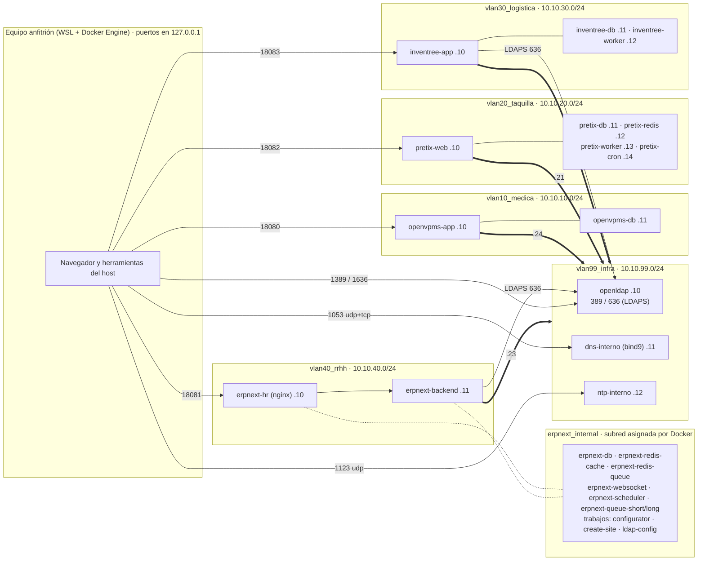

# Arquitectura del sistema en un host

Cómo está montado Reserva Viva: qué contenedores hay, en qué red está cada uno, con qué IP, qué puertos se publican y
cómo se hablan entre sí. Es la **referencia de IP, redes y puertos** de la documentación: el resto de documentos enlaza
aquí. Todo sale del [`docker-compose.yml`](../docker-compose.yml) de la raíz y de [`sistema/test.env`](../sistema/test.env);
si algún día difieren de este documento, manda el código.

Otros documentos: las aplicaciones y su primera entrada en [aplicaciones.md](aplicaciones.md); la CA, LDAPS, cuentas y
exposición en [seguridad.md](seguridad.md); cómo arrancar, parar y diagnosticar en [operacion.md](operacion.md); las
cifras medidas (tiempos, memoria, PASS/FAIL) en [resultados-un-host.md](resultados-un-host.md).

## 1. Visión general

Todo el sistema corre en **un solo equipo**: Docker Engine dentro de WSL (o Docker Desktop), con un único proyecto de
Compose llamado `reservaviva-smoke` (el nombre es histórico; cambiarlo crearía volúmenes nuevos). Son **25 servicios**
agrupados por departamento:

| Departamento | VLAN | Aplicación | Servicios |
|---|---|---|---|
| Unidad Médica Veterinaria | 10 | OpenVPMS | 2 |
| Taquilla y Boletería | 20 | Pretix | 5 |
| Logística y Almacén | 30 | InvenTree | 3 |
| Recursos Humanos | 40 | ERPNext (HR) | 12 |
| Infraestructura transversal | 99 | OpenLDAP (LDAPS, CA interna), bind9, NTP | 3 |

Cada VLAN del diseño es una **red bridge de Docker con su misma subred**. Dos bridges no se enrutan entre sí: esa es la
segmentación. La aplicación de cada departamento está además en `vlan99_infra` para llegar a la infraestructura.

## 2. Diagrama

Los contenedores auxiliares (bases de datos, Redis, workers) van agrupados por aplicación. Las flechas hacia
`vlan99_infra` son la **segunda interfaz** del mismo contenedor, con su IP en esa red.



## 3. Redes

Definidas en la sección `networks:` del compose. La subred de cada VLAN se puede cambiar con `NET_MEDICA`,
`NET_TAQUILLA`, `NET_LOGISTICA`, `NET_RRHH` y `NET_INFRA` (los tres primeros octetos), solo si choca con otra red del
equipo; `sistema/test.env` **no las define**, así que rigen los valores por defecto de la tabla.

| Red | Uso | Subred | Gateway |
|---|---|---|---|
| `vlan10_medica` | Unidad Médica Veterinaria (OpenVPMS) | 10.10.10.0/24 | 10.10.10.1 |
| `vlan20_taquilla` | Taquilla y Boletería (Pretix) | 10.10.20.0/24 | 10.10.20.1 |
| `vlan30_logistica` | Logística y Almacén (InvenTree) | 10.10.30.0/24 | 10.10.30.1 |
| `vlan40_rrhh` | Recursos Humanos (ERPNext) | 10.10.40.0/24 | 10.10.40.1 |
| `vlan99_infra` | Infraestructura: OpenLDAP, DNS, NTP y la segunda interfaz de cada aplicación | 10.10.99.0/24 | 10.10.99.1 |
| `erpnext_internal` | Red privada de ERPNext (MariaDB, Redis, workers). No es una VLAN del diseño | la asigna Docker | la asigna Docker |

El gateway `.1` es la interfaz del bridge en el equipo anfitrión, no un router entre VLAN.

## 4. Servicios

Las imágenes están fijadas por digest en el compose; aquí solo se muestra la etiqueta. `.x` = IP dinámica asignada por
Docker en `erpnext_internal`.

| # | Servicio | Departamento | Contenedor | Redes | IP fija | Imagen | Carpeta |
|---|---|---|---|---|---|---|---|
| 1 | `openvpms-db` | Médica | `openvpms-db` | vlan10 | 10.10.10.11 | `mysql:8.0.46` | [openvpms](../servicios/openvpms/README.md) |
| 2 | `openvpms-app` | Médica | `openvpms-app` | vlan10, vlan99 | 10.10.10.10 · 10.10.99.24 | construida (`build: ./servicios/openvpms`) | [openvpms](../servicios/openvpms/README.md) |
| 3 | `pretix-db` | Taquilla | `pretix-db` | vlan20 | 10.10.20.11 | `postgres:15.19` | [pretix](../servicios/pretix/README.md) |
| 4 | `pretix-redis` | Taquilla | `pretix-redis` | vlan20 | 10.10.20.12 | `redis:7.4.11` | [pretix](../servicios/pretix/README.md) |
| 5 | `pretix-web` | Taquilla | `pretix-web` | vlan20, vlan99 | 10.10.20.10 · 10.10.99.21 | `pretix/standalone:stable` | [pretix](../servicios/pretix/README.md) |
| 6 | `pretix-worker` | Taquilla | `pretix-worker` | vlan20 | 10.10.20.13 | `pretix/standalone:stable` | [pretix](../servicios/pretix/README.md) |
| 7 | `pretix-cron` | Taquilla | `pretix-cron` | vlan20 | 10.10.20.14 | `pretix/standalone:stable` | [pretix](../servicios/pretix/README.md) |
| 8 | `inventree-db` | Logística | `inventree-db` | vlan30 | 10.10.30.11 | `postgres:15.19` | [inventree](../servicios/inventree/README.md) |
| 9 | `inventree-app` | Logística | `inventree-app` | vlan30, vlan99 | 10.10.30.10 · 10.10.99.22 | `inventree/inventree:1.5.5` | [inventree](../servicios/inventree/README.md) |
| 10 | `inventree-worker` | Logística | `inventree-worker` | vlan30 | 10.10.30.12 | `inventree/inventree:1.5.5` | [inventree](../servicios/inventree/README.md) |
| 11 | `erpnext-db` | RRHH | `erpnext-db` | erpnext_internal | .x | `mariadb:10.6.28` | [erpnext](../servicios/erpnext/README.md) |
| 12 | `erpnext-redis-cache` | RRHH | `erpnext-redis-cache` | erpnext_internal | .x | `redis:7.4.11` | [erpnext](../servicios/erpnext/README.md) |
| 13 | `erpnext-redis-queue` | RRHH | `erpnext-redis-queue` | erpnext_internal | .x | `redis:7.4.11` | [erpnext](../servicios/erpnext/README.md) |
| 14 | `erpnext-configurator` | RRHH | `erpnext-configurator` | erpnext_internal | .x | `ghcr.io/frappe/hrms:v15.64.1` | [erpnext](../servicios/erpnext/README.md) |
| 15 | `erpnext-create-site` | RRHH | `erpnext-create-site` | erpnext_internal | .x | `ghcr.io/frappe/hrms:v15.64.1` | [erpnext](../servicios/erpnext/README.md) |
| 16 | `erpnext-ldap-config` | RRHH | `erpnext-ldap-config` | erpnext_internal | .x | `ghcr.io/frappe/hrms:v15.64.1` | [erpnext](../servicios/erpnext/README.md) |
| 17 | `erpnext-backend` | RRHH | `erpnext-backend` | erpnext_internal, vlan40, vlan99 | .x · 10.10.40.11 · 10.10.99.23 | `ghcr.io/frappe/hrms:v15.64.1` | [erpnext](../servicios/erpnext/README.md) |
| 18 | `erpnext-websocket` | RRHH | `erpnext-websocket` | erpnext_internal | .x | `ghcr.io/frappe/hrms:v15.64.1` | [erpnext](../servicios/erpnext/README.md) |
| 19 | `erpnext-scheduler` | RRHH | `erpnext-scheduler` | erpnext_internal | .x | `ghcr.io/frappe/hrms:v15.64.1` | [erpnext](../servicios/erpnext/README.md) |
| 20 | `erpnext-queue-short` | RRHH | `erpnext-queue-short` | erpnext_internal | .x | `ghcr.io/frappe/hrms:v15.64.1` | [erpnext](../servicios/erpnext/README.md) |
| 21 | `erpnext-queue-long` | RRHH | `erpnext-queue-long` | erpnext_internal | .x | `ghcr.io/frappe/hrms:v15.64.1` | [erpnext](../servicios/erpnext/README.md) |
| 22 | `erpnext-hr` | RRHH | `erpnext-hr` | erpnext_internal, vlan40 | .x · 10.10.40.10 | `ghcr.io/frappe/hrms:v15.64.1` | [erpnext](../servicios/erpnext/README.md) |
| 23 | `openldap` | Infraestructura | `openldap` | vlan99 | 10.10.99.10 | `osixia/openldap:1.5.0` | [openldap](../servicios/openldap/README.md), [ca](../servicios/ca/README.md) |
| 24 | `dns` | Infraestructura | `dns-interno` | vlan99 | 10.10.99.11 | `internetsystemsconsortium/bind9:9.18` | [bind9](../servicios/bind9/README.md) |
| 25 | `ntp` | Infraestructura | `ntp-interno` | vlan99 | 10.10.99.12 | `cturra/ntp:latest` | [ntp](../servicios/ntp/README.md) |

**Trabajos de inicialización.** `erpnext-configurator`, `erpnext-create-site` y `erpnext-ldap-config` tienen
`restart: "no"`: ejecutan su script y terminan en `Exited (0)`, que es su estado correcto. Van encadenados con
`depends_on`: `erpnext-db` sano → `configurator` → `create-site` → `ldap-config`; `erpnext-backend`, `websocket`,
`scheduler` y las dos colas esperan a que `create-site` termine con éxito.

Otras dependencias de arranque: `openvpms-app` espera a que `openvpms-db` esté sano; `pretix-worker` y `pretix-cron`, a
`pretix-web` sano (solo `pretix-web` migra la base); `inventree-worker`, a `inventree-app` sano. Los servicios con
healthcheck son `openvpms-db`, `openvpms-app`, `pretix-web`, `inventree-app`, `erpnext-db` y `erpnext-hr`.

## 5. Doble conexión: aplicación ↔ vlan99_infra

OpenLDAP, bind9 y NTP viven en `vlan99_infra`, y entre bridges no hay enrutamiento. Por eso el contenedor de cada
aplicación que necesita la infraestructura tiene **dos interfaces**: una en la VLAN de su departamento y otra en
`vlan99_infra` con IP fija (`openvpms-app` .24, `pretix-web` .21, `inventree-app` .22, `erpnext-backend` .23). En ERPNext
la doble conexión la tiene `erpnext-backend`, que es quien habla con OpenLDAP; `erpnext-hr` (nginx) solo está en
`vlan40_rrhh` y en `erpnext_internal`. Los contenedores auxiliares (bases de datos, Redis, workers) solo están en su red
y no llegan a la infraestructura.

OpenVPMS y Pretix no usan LDAP ([ldap.md](ldap.md)), pero conservan la pata en
`vlan99_infra` para llegar a DNS y NTP, igual que en el diseño.

**Lo que un solo host no aísla:** `vlan99_infra` es un único dominio L2 compartido por las cuatro aplicaciones, así que
se alcanzan entre sí por su IP de infraestructura. Está explicado en
[seguridad.md, "Qué no aísla un solo host"](seguridad.md#qué-no-aísla-un-solo-host-limitación-conocida), y la
comprobación que lo muestra, en [`verificar_arquitectura.md`](../sistema/verificar_arquitectura.md).

## 6. Flujos

### Login LDAP de ERPNext e InvenTree

1. El usuario entra en la web de la aplicación (`erpnext-hr` → `erpnext-backend`, o `inventree-app`).
2. La aplicación abre `ldaps://ldap.reservaviva.local:636`. El nombre lo resuelve su `extra_hosts` a `10.10.99.10`
   (`openldap`), y el tráfico sale por su interfaz en `vlan99_infra`.
3. Verifica el certificado de OpenLDAP con la CA interna montada en `/certs/ca.crt` (desde
   `servicios/ca/certs/ca.crt`). El nombre coincide con el SAN del certificado.
4. Hace bind con la cuenta de servicio `cn=svc-lectura,ou=servicios`, busca el `uid` solo en la OU de su departamento
   (`ou=rrhh` para ERPNext, `ou=operaciones` para InvenTree) y después hace bind con la clave del propio usuario.

En ERPNext, `erpnext-ldap-config` solo escribe "LDAP Settings" en la base; no se conecta a OpenLDAP y por eso no
necesita `vlan99_infra`. Detalle y pruebas en
[ldap.md](ldap.md); cuentas y ACL en
[seguridad.md](seguridad.md#3-ldap-y-ldaps).

### Resolución de nombres: DNS de Docker frente a bind9

- **Ningún servicio define `dns:`** en el compose, así que todos los contenedores usan el **DNS embebido de Docker**, que
  resuelve los nombres de servicio y de contenedor dentro de cada red compartida. Así se encuentran los componentes de
  ERPNext en `erpnext_internal` (`erpnext-db`, `erpnext-redis-cache`, `erpnext-redis-queue`, `erpnext-backend:8000`,
  `erpnext-websocket:9000`). Pretix, InvenTree y OpenVPMS llegan a su base y a Redis por **IP fija**.
- **bind9 (`dns-interno`, 10.10.99.11)** es el servidor autoritativo de `reservaviva.local`, sin recursión
  ([`named.conf`](../servicios/bind9/named.conf)). Lo consultan la verificación (desde `vlan99_infra` y desde las
  aplicaciones) y el equipo anfitrión por `localhost:1053`. Las aplicaciones no dependen de él.
- **`extra_hosts`** fija `ldap.reservaviva.local → 10.10.99.10` en `inventree-app` y `erpnext-backend`, los dos
  contenedores que hacen LDAPS. Así el nombre coincide con el certificado sin depender de ningún DNS.

### La zona `reservaviva.local`

La plantilla [`db.reservaviva.local.tpl`](../servicios/bind9/zones/db.reservaviva.local.tpl) tiene un marcador por nombre
(`${IP_DNS}`, `${IP_LDAP}`…). La función `generar_zona` de [`levantar-sistema.sh`](../levantar-sistema.sh) (acción
`preparar`, y también `arrancar`) sustituye cada marcador por la IP fija del contenedor, con las mismas `NET_*` y valores
por defecto que el compose, y el `${SERIAL}` por la fecha. Escribe `servicios/bind9/zones/db.reservaviva.local` (fuera de
git) y solo lo reemplaza si cambió algo más que el serial. Si la zona es más nueva que el arranque de `dns-interno`, el
script reinicia ese contenedor para que bind9 la lea.

| Nombre | IP | Contenedor | Red |
|---|---|---|---|
| `dns.reservaviva.local` | 10.10.99.11 | `dns-interno` | vlan99 |
| `ldap.reservaviva.local` | 10.10.99.10 | `openldap` | vlan99 |
| `ntp.reservaviva.local` | 10.10.99.12 | `ntp-interno` | vlan99 |
| `openvpms.reservaviva.local` | 10.10.10.10 | `openvpms-app` | vlan10 |
| `pretix.reservaviva.local` | 10.10.20.10 | `pretix-web` | vlan20 |
| `inventree.reservaviva.local` | 10.10.30.10 | `inventree-app` | vlan30 |
| `rrhh.reservaviva.local` | 10.10.40.10 | `erpnext-hr` (nginx, el que atiende HTTP) | vlan40 |

`levantar-sistema.sh verificar` comprueba que cada nombre apunta a la IP real del contenedor
([`verificar_arquitectura.md`](../sistema/verificar_arquitectura.md), bloque 2).

### NTP

`ntp-interno` (10.10.99.12, imagen `cturra/ntp`) sirve su propio reloj con stratum 10, sin salida a Internet
(`NTP_SERVERS: "127.127.1.1"`; el porqué está en el compose y en [su README](../servicios/ntp/README.md)). Es alcanzable
desde `vlan99_infra` y, por tanto, desde las cuatro aplicaciones, y desde el anfitrión por `localhost:1123/udp`. Ningún
servicio del compose está configurado como cliente suyo: en `openvpms-app`, `NTP_HOST` es una variable informativa que
nada lee. Quien lo usa es la verificación, con un cliente SNTP y un cliente chrony real.

## 7. Puertos publicados

Valores de [`sistema/test.env`](../sistema/test.env). Todo se publica en `127.0.0.1` (`PUBLISH_IP`, y `DNS_BIND_IP` para
bind9): solo se entra desde el propio equipo. Los puertos del host están desplazados porque OpenVPMS y ERPNext escuchan
ambos en 8080, y 53/udp y 123/udp suelen estar ocupados en Windows.

| Servicio (contenedor) | Puerto del host | Puerto del contenedor | Dirección | Variable |
|---|---|---|---|---|
| OpenVPMS (`openvpms-app`) | 18080 (`/openvpms`) | 8080 | `PUBLISH_IP` = 127.0.0.1 | `OPENVPMS_PORT` |
| ERPNext (`erpnext-hr`) | 18081 | 8080 | `PUBLISH_IP` = 127.0.0.1 | `ERPNEXT_PORT` |
| Pretix (`pretix-web`) | 18082 | 80 | `PUBLISH_IP` = 127.0.0.1 | `PRETIX_PORT` |
| InvenTree (`inventree-app`) | 18083 | 8000 | `PUBLISH_IP` = 127.0.0.1 | `INVENTREE_PORT` |
| OpenLDAP, sin cifrar (`openldap`) | 1389 | 389 | `PUBLISH_IP` = 127.0.0.1 | `LDAP_PORT` |
| OpenLDAP, LDAPS (`openldap`) | 1636 | 636 | `PUBLISH_IP` = 127.0.0.1 | `LDAPS_PORT` |
| bind9 (`dns-interno`) | 1053 udp y tcp | 53 | `DNS_BIND_IP` = 127.0.0.1 | `DNS_PORT` |
| NTP (`ntp-interno`) | 1123 udp | 123 | `PUBLISH_IP` = 127.0.0.1 | `NTP_PORT` |

Ningún otro contenedor publica puertos: `erpnext-backend` (gunicorn, 8000) y las bases de datos solo son alcanzables
desde sus redes.

**Si faltara una variable**, el compose usa sus valores por defecto: la dirección `127.0.0.1` (igual que `test.env`; antes
era `0.0.0.0`, todas las interfaces) y los puertos originales (8080, 8080, 80, 8000, 389, 636, 53 y 123). Con esos valores
OpenVPMS y ERPNext chocarían en el 8080. Hay que arrancar siempre con `--env-file sistema/test.env`, como hace
`levantar-sistema`.

Las URL de Pretix e InvenTree (`PRETIX_PRETIX_URL`, `INVENTREE_SITE_URL`) son `http://localhost:<puerto publicado>`: las
dos aplicaciones rechazan otro nombre de host ([aplicaciones.md](aplicaciones.md)).

## 8. Estructura del repositorio

```
docker-compose.yml         el único compose: 25 servicios, 6 redes y los volúmenes
servicios/
  openvpms/                Dockerfile propio, entrypoint reanudable y su prueba
  pretix/                  solo README (configuración en el compose)
  inventree/               solo README (configuración en el compose)
  erpnext/                 prueba de erpnext-create-site
  openldap/                LDIF de ACL, estructura y usuarios de prueba
  ca/                      generar-certificados.sh; certs/ (fuera de git)
  bind9/                   named.conf y plantilla de zona
  ntp/                     solo README
sistema/                   test.env (variables) y scripts de verificación
levantar-sistema.sh        arranque, preparación, estado, verificación (.ps1 y .cmd: lanzadores desde Windows)
docs/                      documentación (este documento, aplicaciones, seguridad, operación, LDAP, resultados)
diseno-red/                anexo: diseño de 3 equipos con VLAN 802.1Q y switch (no se despliega)
```

## 9. Diferencias con el diseño de 3 equipos

El anexo [`../diseno-red/`](../diseno-red/README.md) describe el despliegue para el laboratorio físico
([`arquitectura-3-equipos-departamentos.md`](../diseno-red/arquitectura-3-equipos-departamentos.md)): PC-1 con Médica,
PC-2 con Taquilla y Logística, y PC-3 con RRHH e infraestructura, unidos por un switch con VLAN 802.1Q. Las subredes son
las mismas. Lo que cambia en un host:

- **Sin switch ni etiquetado 802.1Q.** Cada VLAN es un bridge de Docker; no hay puertos de acceso ni troncales.
- **Sin enrutamiento entre VLAN.** En el diseño, el switch L3 (SVI `10.10.X.1` y ACL) o el firewall de PC-3
  (router-on-a-stick con `nftables`) aplican la matriz de segmentación y permiten el tráfico hacia VLAN 99. Aquí no
  existe ninguno de los dos: el acceso a la infraestructura se consigue con la doble conexión (sección 5), y el `.1` de
  cada red es solo la interfaz del bridge.
- **Direcciones.** En el diseño, `10.10.99.10` es PC-3 y da LDAP, DNS y NTP a la vez. Aquí cada servicio es un contenedor
  con su propia IP (sección 6, zona).
- **Una sola CA** montada desde `servicios/ca/certs/`, en lugar de una copia por equipo.
